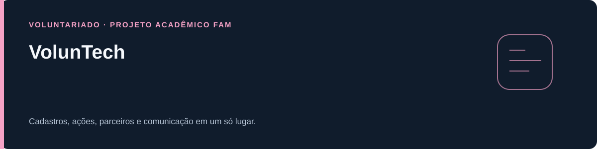
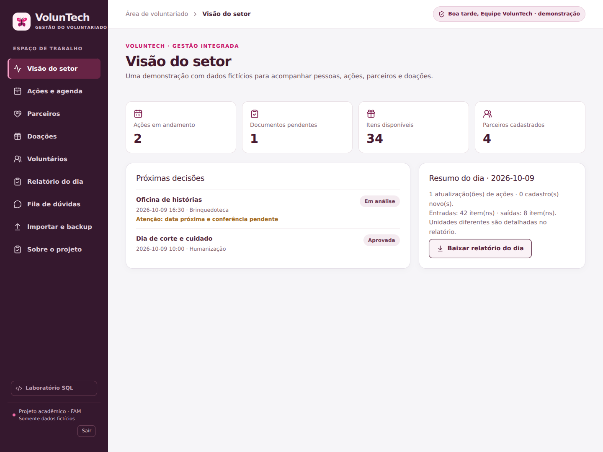

# VolunTech · Gestão de Voluntariado



Aplicação acadêmica da FAM para organizar voluntários, ações, parceiros, doações e a comunicação da equipe. O projeto tem interface própria com borboleta, versão desktop e laboratório SQL para explorar o banco e compreender as consultas.

[Baixar instaladores](https://github.com/bruno-dsn/VolunTech-FAM/releases) · [Instalação e desenvolvimento](DOCUMENTACAO/INSTALACAO-E-DISTRIBUICAO.md) · [Laboratório SQL](DOCUMENTACAO/banco-de-dados/TUTORIAL-LABORATORIO-SQL.md) · [Histórico](CHANGELOG.md)

## Conheça a interface



A navegação separa visão geral, voluntários, operações e ferramentas. O acesso inicial tem um botão para preencher as credenciais públicas da demonstração; o envio do formulário continua sendo uma ação do visitante.

## O que você pode explorar

| Área | Experiência |
| --- | --- |
| Voluntários | Cadastrar, editar e buscar por nome ou CPF; conferir cadastros incompletos |
| Operações | Explorar parceiros, ações, agenda, participantes e doações fictícias |
| Importação e exportação | Trabalhar com as bases de demonstração em CSV, JSON e Excel |
| Comunicação | Enviar uma pergunta no canal público e acompanhar a fila pela gestão |
| Laboratório SQL | Inspecionar o modelo, executar consultas de leitura e seguir o tutorial |
| Compartilhamento | Abrir os canais públicos usando os QR Codes gerados para o endereço do ambiente |

## Primeiro uso

1. Abra a [página de Releases](https://github.com/bruno-dsn/VolunTech-FAM/releases).
2. Escolha o instalador do seu sistema: Windows, macOS Intel ou macOS Apple Silicon.
3. Inicie o VolunTech, informe um nome e a senha pública de demonstração `VolunTech2026!`.
4. Explore um cadastro, uma ação e o laboratório SQL. Use registros fictícios durante a apresentação.

A release existente é a **v1.0.5**. As melhorias de interface desta revisão, incluindo o botão **Preencher acesso de demonstração**, estão no código da branch `main`; os instaladores de uma release anterior só recebem essas mudanças quando um novo build é publicado. `Source code (zip)` é o código-fonte, e não o instalador.

No macOS, os instaladores existentes usam assinatura ad-hoc e não possuem notarização Apple. O [guia de instalação](DOCUMENTACAO/INSTALACAO-E-DISTRIBUICAO.md) documenta o procedimento de primeira abertura e os diagnósticos.

## Executar a partir do código

Requisitos: Node.js **22.13 ou superior** e pnpm **11.25.0**. A versão declarada do código desktop é `1.0.5`.

```bash
git clone https://github.com/bruno-dsn/VolunTech-FAM.git
cd VolunTech-FAM
pnpm install --frozen-lockfile
pnpm dev
```

O comando inicia o ambiente do aplicativo. Os detalhes de execução, banco local, rede e geração dos instaladores estão no [manual](DOCUMENTACAO/INSTALACAO-E-DISTRIBUICAO.md).

## Verificar uma mudança

```bash
pnpm exec tsc --noEmit
pnpm lint
node scripts/test-sql-lab.mjs
pnpm build
```

TypeScript verifica os tipos; ESLint verifica o código; o script exercita o contrato de consultas do laboratório. O build da aplicação não substitui a validação dos instaladores no Windows ou macOS.

Para o teste SQL, mantenha `pnpm dev` aberto em outro terminal. Se o servidor usar outro endereço, passe-o ao script: `node scripts/test-sql-lab.mjs http://127.0.0.1:5174`.

## Como o projeto está organizado

| Pasta | Responsabilidade |
| --- | --- |
| `app/` | Páginas, estilos e rotas da aplicação |
| `components/voluntech/` | Componentes da experiência de voluntariado |
| `lib/` | Validações, importação, operações e laboratório SQL |
| `db/` e `drizzle/` | Modelo de dados e migrações |
| `scripts/` | Execução local, verificação e distribuição |
| `DOCUMENTACAO/` | Documentação acadêmica, MER/DER e tutoriais |

Tecnologias: React, TypeScript, runtime compatível com Next, Cloudflare D1/SQLite, Drizzle, Electron e CSS. O repositório preserva os fluxos específicos do ambiente de desenvolvimento e do aplicativo desktop.

## Limites da demonstração

Os registros, contas de apresentação e doações são fictícios. A senha pública `VolunTech2026!` facilita a apresentação e **não protege dados reais**. O QR de doação abre uma mensagem simbólica; não processa pagamentos. O assistente da aplicação usa o comportamento implementado no projeto e não deve ser apresentado como um serviço clínico ou uma IA validada para decisões hospitalares.

Este projeto não deve receber dados de pacientes ou informações reais de um hospital. Para uso operacional, seriam necessários identidade individual, controle de acesso, gestão de segredos, revisão de privacidade e validação no ambiente da instituição.

Desenvolvido pela **Equipe VolunTech · FAM**. Consulte a [documentação](DOCUMENTACAO/README.md) e o [histórico de mudanças](CHANGELOG.md).
