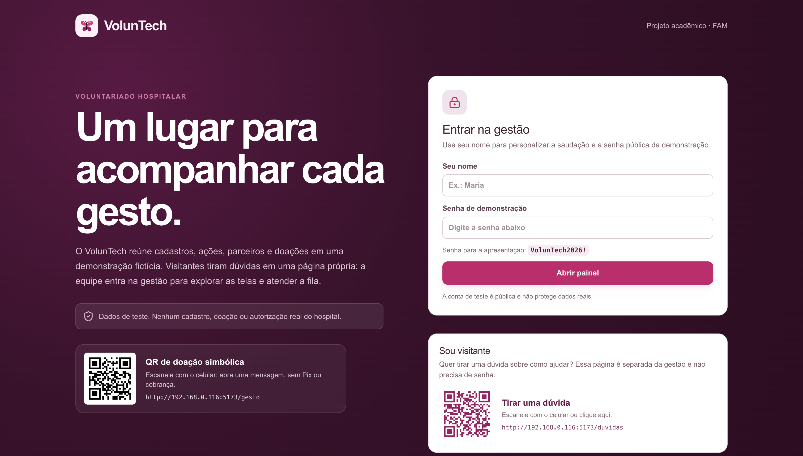
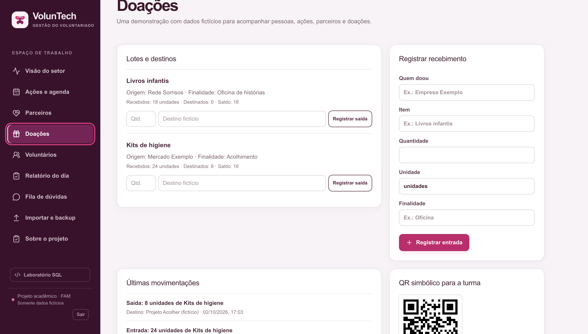
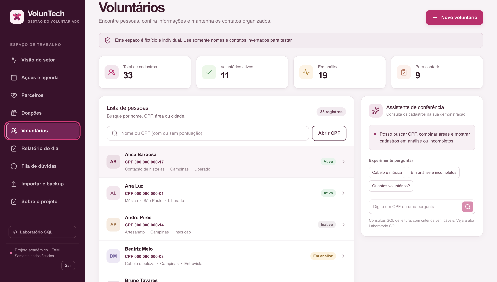
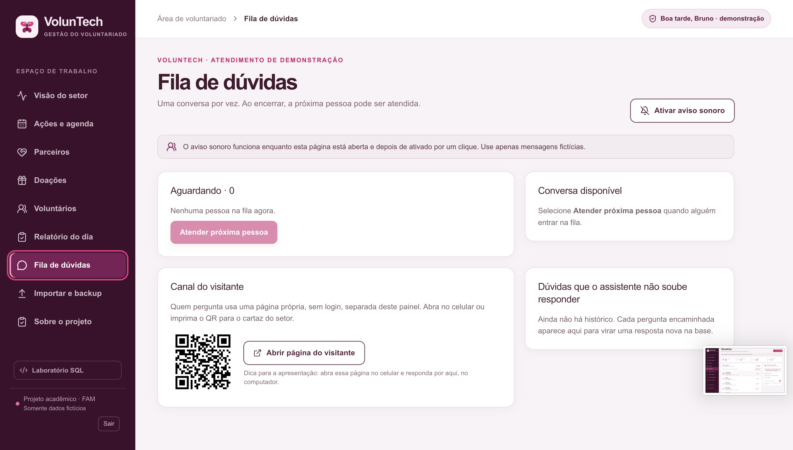
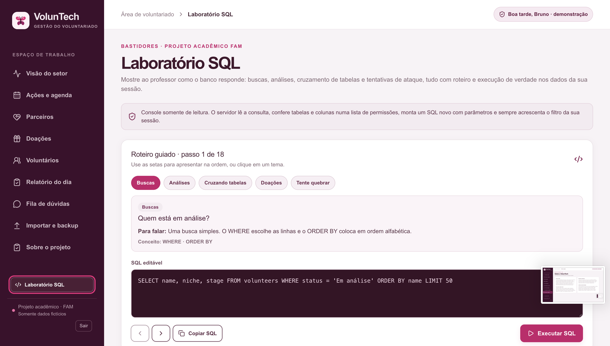

# VolunTech-FAM

**Sistema acadêmico de gestão de voluntariado desenvolvido para a FAM.**

O **VolunTech** é uma aplicação desktop desenvolvida como projeto acadêmico para demonstrar uma solução de gestão de voluntariado, instituições, doações, voluntários, agenda, comunicação e recursos relacionados.

> **Importante:** este projeto possui finalidade acadêmica e demonstrativa. Os dados utilizados são fictícios e o sistema não deve ser utilizado para administrar dados reais de pacientes, hospitais ou outras informações sensíveis.

**Versão atual: `v1.0.5`**

---

## Navegação

* [Download](#download)
* [Conheça o VolunTech](#conheça-o-voluntech)
* [Funcionalidades](#funcionalidades)
* [Demonstração](#demonstração)
* [Documentação](#documentação)
* [Tecnologias](#tecnologias)
* [Desenvolvimento](#desenvolvimento)
* [Arquitetura](#arquitetura)
* [GitHub Actions](#github-actions)
* [Histórico de versões](#histórico-de-versões)
* [Limites da demonstração](#limites-da-demonstração)

---

# Download

A versão mais recente do VolunTech é a **v1.0.5**.

Os instaladores oficiais são publicados automaticamente na área de **Releases** do GitHub.

## Windows

Baixe:

**`VolunTech-Setup-1.0.5.exe`**

O instalador configura o aplicativo no Windows e cria os atalhos necessários.

## macOS — Apple Silicon

Para Macs com processadores Apple Silicon, como M1, M2, M3 ou M4:

**`VolunTech-1.0.5-arm64.dmg`**

## macOS — Intel

Para Macs com processador Intel:

**`VolunTech-1.0.5-x64.dmg`**

## Releases

Os instaladores oficiais estão disponíveis em:

https://github.com/bruno-dsn/VolunTech-FAM/releases

> **Atenção:** os arquivos `Source code (zip)` e `Source code (tar.gz)` disponibilizados pelo GitHub são apenas cópias do código-fonte do projeto. Eles **não são instaladores do aplicativo**.

---

## macOS — primeira execução

A versão `v1.0.5` utiliza **assinatura ad-hoc** para o aplicativo macOS, mas não possui assinatura de desenvolvedor Apple nem notarização pela Apple.

Por isso, dependendo das configurações de segurança do macOS, o sistema pode solicitar uma confirmação adicional na primeira execução.

Depois de abrir o arquivo `.dmg` e arrastar o **VolunTech** para a pasta **Aplicativos**, caso o macOS impeça a abertura do aplicativo, utilize a opção de abrir pelo menu de contexto:

**Control + clique → Abrir**

Também é possível verificar as opções de segurança do sistema caso o macOS apresente um bloqueio.

> A assinatura ad-hoc utilizada nesta versão não equivale à assinatura oficial de desenvolvedor Apple e não substitui o processo de notarização.

---

# Conheça o VolunTech

O VolunTech foi desenvolvido como uma solução acadêmica para representar um sistema de apoio à gestão de voluntariado.

A aplicação reúne diferentes áreas em uma interface desktop:

* voluntários;
* instituições;
* doações;
* agenda;
* ações;
* comunicação;
* dúvidas;
* atualizações;
* laboratório SQL;
* importação e backup;
* recursos públicos acessíveis por QR Code.

O projeto também demonstra a integração entre uma aplicação desktop Electron e uma aplicação web executada localmente.

---

# Funcionalidades

| Área                         | Descrição                                                |
| ---------------------------- | -------------------------------------------------------- |
| **Visão do setor**           | Apresentação geral das informações do sistema            |
| **Ações e agenda**           | Organização de ações, atividades e compromissos          |
| **Instituições e parceiros** | Cadastro e gerenciamento de instituições e parceiros     |
| **Doações**                  | Registro e acompanhamento de doações                     |
| **Voluntários**              | Cadastro e gerenciamento de voluntários                  |
| **Atualizações de hoje**     | Visualização de informações e atividades recentes        |
| **Fila de dúvidas**          | Organização das dúvidas recebidas                        |
| **Canal do visitante**       | Acesso público para interação com o sistema              |
| **Laboratório SQL**          | Ambiente acadêmico para demonstração de consultas SQL    |
| **Importar e backup**        | Recursos relacionados à importação e cópia dos dados     |
| **Sobre o projeto**          | Informações sobre o VolunTech e sua finalidade acadêmica |

---

# Acesso ao sistema

O sistema possui uma tela de login para acesso às áreas administrativas.

Para a demonstração acadêmica, são utilizados dados de acesso fictícios.

### Nome

Pode ser utilizado qualquer nome contendo pelo menos duas letras.

### Senha

```text
VolunTech2026!
```

> Essas credenciais existem exclusivamente para demonstração acadêmica. Não devem ser utilizadas como mecanismo de segurança para dados reais ou informações confidenciais.

---

# Demonstração

A interface principal do VolunTech é composta por diferentes módulos destinados à demonstração das funcionalidades do projeto.

## Tela inicial



## Doações



## Voluntários



## Fila de dúvidas



## Laboratório SQL



---

# Canal público e QR Codes

O VolunTech possui recursos que podem ser acessados por outros dispositivos conectados à mesma rede local.

Entre os caminhos públicos utilizados pelo sistema estão:

```text
/duvidas
/gesto
/api/chat
```

Esses recursos permitem demonstrar uma experiência em que um visitante pode acessar determinados conteúdos pelo navegador ou por QR Code.

Para que o acesso funcione em outro dispositivo:

1. o computador que executa o VolunTech deve estar conectado à rede local;
2. o dispositivo visitante deve estar na mesma rede;
3. o firewall do computador deve permitir a comunicação necessária;
4. o endereço de rede utilizado pelo VolunTech deve ser acessível pelos dispositivos da rede.

Esses recursos fazem parte da demonstração acadêmica e não devem ser utilizados para disponibilizar informações sensíveis em uma rede real.

---

# Documentação

A documentação complementar do projeto está disponível na pasta:

```text
DOCUMENTACAO/
```

Entre os materiais está o documento:

```text
DOCUMENTACAO/VolunTech-Historia-e-Visao-Geral.pdf
```

A documentação apresenta informações sobre a história, visão geral e desenvolvimento do projeto.

---

# Tecnologias

O VolunTech utiliza diferentes tecnologias para demonstrar uma arquitetura moderna de aplicação desktop e web.

| Tecnologia             | Utilização                                                  |
| ---------------------- | ----------------------------------------------------------- |
| **React**              | Construção da interface                                     |
| **TypeScript**         | Tipagem e desenvolvimento da aplicação                      |
| **Next.js / Vinext**   | Estrutura da aplicação                                      |
| **Vite**               | Ferramentas de desenvolvimento e build                      |
| **Electron**           | Aplicação desktop                                           |
| **Cloudflare Workers** | Ambiente relacionado à aplicação                            |
| **Miniflare**          | Ambiente local de desenvolvimento                           |
| **SQLite**             | Banco de dados local                                        |
| **Cloudflare D1**      | Integração de banco compatível com o ecossistema Cloudflare |
| **Drizzle ORM**        | Mapeamento e operações com banco de dados                   |
| **pnpm**               | Gerenciamento de dependências                               |
| **Git**                | Controle de versão                                          |
| **GitHub**             | Hospedagem do código e Releases                             |
| **GitHub Actions**     | Automação de build e publicação                             |

---

# Inteligência Artificial no desenvolvimento

Ferramentas de Inteligência Artificial foram utilizadas como apoio ao processo de desenvolvimento do projeto.

Entre os usos estão:

* apoio à programação;
* análise de código;
* documentação;
* identificação de possíveis problemas;
* sugestões de implementação;
* revisão de componentes;
* organização do projeto;
* apoio à manutenção e evolução do sistema.

A utilização de ferramentas de IA não significa que o sistema possua necessariamente recursos de IA em todas as suas funcionalidades.

> **Observação:** o projeto atualmente **não possui um sistema RAG implementado**.

---

# Desenvolvimento

## Requisitos

Para executar o projeto em ambiente de desenvolvimento, são recomendados:

* **Node.js:** `>= 22.13.0`
* **pnpm:** `11.25.0`

---

## Instalação das dependências

Depois de clonar o projeto:

```bash
pnpm install
```

---

## Executar o aplicativo Electron

Para iniciar o VolunTech como aplicação desktop:

```bash
pnpm electron
```

Também existe o comando:

```bash
pnpm electron:dev
```

---

## Executar o ambiente de desenvolvimento

Para iniciar o ambiente de desenvolvimento:

```bash
pnpm dev
```

O servidor utiliza a infraestrutura definida em:

```text
scripts/electron-server.mjs
```

Essa configuração permite que o sistema identifique o endereço de rede local utilizado para disponibilizar determinados recursos do VolunTech.

Após iniciar o servidor, a aplicação pode ser acessada localmente pela porta:

```text
5173
```

O endpoint abaixo pode ser utilizado para verificar as informações de rede:

```text
http://localhost:5173/api/network
```

---

# Scripts disponíveis

Os principais scripts definidos no projeto incluem:

| Comando               | Finalidade                                     |
| --------------------- | ---------------------------------------------- |
| `pnpm dev`            | Inicia o ambiente de desenvolvimento           |
| `pnpm build`          | Gera o build da aplicação                      |
| `pnpm start`          | Inicia a aplicação em modo de produção         |
| `pnpm electron`       | Executa a aplicação Electron                   |
| `pnpm electron:dev`   | Executa o Electron em desenvolvimento          |
| `pnpm electron:build` | Gera o build relacionado ao Electron           |
| `pnpm lint`           | Executa as verificações de lint                |
| `pnpm db:generate`    | Gera recursos relacionados ao banco            |
| `pnpm dist:win`       | Gera o instalador Windows                      |
| `pnpm dist:mac`       | Gera o instalador macOS                        |
| `pnpm dist`           | Executa o processo de distribuição configurado |

---

# Estrutura do projeto

A estrutura principal do projeto é organizada da seguinte forma:

```text
VolunTech-FAM/
├── app/
├── components/
│   └── voluntech/
├── db/
├── drizzle/
├── lib/
├── public/
├── scripts/
├── build/
├── vendor/
├── DOCUMENTACAO/
├── Fotos/
├── main.js
├── package.json
├── pnpm-lock.yaml
├── vite.config.ts
├── drizzle.config.ts
├── CHANGELOG.md
└── README.md
```

---

# Arquitetura

O VolunTech utiliza uma arquitetura composta por diferentes camadas.

## Aplicação desktop

O **Electron** é responsável por executar o VolunTech como aplicativo desktop.

O aplicativo desktop coordena a execução da aplicação e seus recursos locais.

## Aplicação e servidor

A aplicação utiliza um processo separado para executar os recursos necessários do servidor local.

Essa organização permite que a aplicação desktop utilize os mesmos recursos da aplicação web enquanto mantém a experiência de uso de um aplicativo instalado.

## Runtime

O projeto possui uma estrutura para manter determinados arquivos de runtime fora da aplicação empacotada, evitando problemas relacionados à escrita em diretórios protegidos do aplicativo.

A aplicação também considera o comportamento do pacote **ASAR** utilizado pelo Electron.

---

# Banco de dados

O projeto utiliza uma combinação de tecnologias relacionadas a banco de dados:

* SQLite;
* Cloudflare D1;
* Drizzle ORM.

O schema principal encontra-se em:

```text
db/schema.ts
```

As migrações relacionadas ao banco encontram-se em:

```text
drizzle/
```

---

# Configuração de rede

O VolunTech possui configurações relacionadas ao acesso pela rede local.

Entre as variáveis utilizadas estão:

```text
VOLUNTECH_LAN=0
VOLUNTECH_PUBLIC_URL=https://...
VOLUNTECH_PORT=5173
```

A porta padrão utilizada pelo servidor local é:

```text
5173
```

Quando necessário, a aplicação pode identificar o endereço de rede local da máquina para permitir a demonstração dos recursos públicos em outros dispositivos.

---

# Build dos instaladores

Os instaladores podem ser gerados utilizando os comandos:

## Windows

```bash
pnpm dist:win
```

## macOS

```bash
pnpm dist:mac
```

## Distribuição

```bash
pnpm dist
```

Os arquivos gerados são disponibilizados no diretório:

```text
release/
```

Na Release `v1.0.5`, os instaladores oficiais publicados são:

```text
VolunTech-Setup-1.0.5.exe
VolunTech-1.0.5-arm64.dmg
VolunTech-1.0.5-x64.dmg
```

---

# GitHub Actions

O projeto possui um workflow de automação localizado em:

```text
.github/workflows/build-desktop.yml
```

O workflow é responsável por automatizar a construção dos instaladores desktop.

Atualmente são gerados:

* instalador Windows;
* instalador macOS para Apple Silicon (`arm64`);
* instalador macOS para Intel (`x64`).

## Windows

O workflow utiliza um ambiente Windows para gerar:

```text
VolunTech-Setup-X.Y.Z.exe
```

## macOS

O workflow utiliza ambientes macOS específicos para gerar:

```text
VolunTech-X.Y.Z-arm64.dmg
VolunTech-X.Y.Z-x64.dmg
```

## Validação dos DMGs

Os builds macOS passam por uma etapa automatizada de validação.

Durante essa etapa, o workflow:

1. localiza o arquivo `.dmg`;
2. monta o DMG;
3. verifica a existência do `VolunTech.app`;
4. verifica o identificador do aplicativo;
5. verifica o executável principal;
6. inspeciona a assinatura do aplicativo;
7. confirma a condição esperada para a assinatura acadêmica;
8. finaliza a validação do build.

A versão `v1.0.5` utiliza assinatura **ad-hoc** no aplicativo macOS.

Essa assinatura não é uma assinatura oficial de desenvolvedor Apple e não representa notarização pela Apple.

---

# Publicação de uma Release

O processo de publicação utiliza **tags do Git**.

Uma nova versão pode ser criada seguindo o padrão:

```bash
git tag vX.Y.Z
git push origin vX.Y.Z
```

Quando uma tag no formato:

```text
v*
```

é publicada no GitHub, o workflow:

```text
Build desktop installers
```

é iniciado automaticamente.

O workflow então:

1. instala as dependências;
2. gera o instalador Windows;
3. gera os instaladores macOS;
4. valida os DMGs;
5. publica os artefatos;
6. cria ou atualiza a GitHub Release correspondente;
7. disponibiliza os instaladores para download.

---

## Release v1.0.5

A versão `v1.0.5` é a versão atual do VolunTech.

Os instaladores publicados são:

```text
VolunTech-Setup-1.0.5.exe
VolunTech-1.0.5-arm64.dmg
VolunTech-1.0.5-x64.dmg
```

A Release oficial está disponível em:

https://github.com/bruno-dsn/VolunTech-FAM/releases/tag/v1.0.5

Os arquivos publicados também possuem hashes **SHA-256** disponibilizados pelo GitHub para verificação de integridade.

---

# Execução manual do workflow

Também é possível executar o workflow manualmente pelo GitHub.

No repositório:

1. acesse **Actions**;
2. selecione **Build desktop installers**;
3. selecione **Run workflow**;
4. escolha a branch desejada;
5. execute o workflow.

A execução manual é útil para testes do processo de build.

A publicação automática de uma Release está associada às execuções iniciadas por tags no formato `v*`.

---

# Diagnóstico e validação do macOS

O projeto possui scripts específicos para auxiliar na análise do processo de build macOS.

Entre eles:

```text
scripts/adhoc-sign.cjs
scripts/diagnose-macos-build.sh
scripts/validate-macos-build.sh
```

Esses scripts fazem parte da infraestrutura criada para auxiliar a construção, assinatura ad-hoc, diagnóstico e validação dos aplicativos macOS.

---

# Verificação antes de publicar alterações

Antes de realizar commits ou publicar uma nova versão, alguns comandos úteis são:

```bash
git status
```

Para verificar as alterações:

```bash
git diff
```

Para verificar problemas de espaços ou formatação:

```bash
git diff --check
```

Para visualizar o histórico:

```bash
git log --oneline
```

Para visualizar as tags:

```bash
git tag
```

Para verificar a versão definida no projeto:

```bash
cat package.json
```

---

# Histórico de versões

## v1.0.5

**Versão atual do VolunTech.**

Inclui:

* assinatura ad-hoc do aplicativo macOS;
* instalador macOS incluído no DMG;
* geração de instaladores para macOS Apple Silicon e Intel;
* validação automatizada dos DMGs;
* diagnóstico e validação do processo de build macOS;
* publicação automatizada dos instaladores através do GitHub Actions;
* instalador Windows atualizado;
* Release oficial publicada no GitHub.

---

## v1.0.3

Versão que consolidou melhorias na aplicação desktop, documentação, apresentação do projeto e distribuição dos instaladores.

Incluiu atualizações no README, organização das imagens do projeto e melhorias relacionadas ao processo de distribuição.

---

## v1.0.2

Release que trouxe correções relacionadas aos QR Codes e à identificação do endereço de rede utilizado durante o desenvolvimento.

Entre os ajustes estavam:

* correção dos caminhos dos QR Codes;
* melhoria da descoberta do endereço de rede local;
* atualização do servidor de desenvolvimento;
* ajustes no fluxo de execução do aplicativo desktop.

---

## v1.0.1

Release relacionada a correções no processo de publicação dos instaladores desktop.

---

## v1.0.0

Primeira versão do projeto VolunTech-FAM.

---

# Arquivos importantes

| Arquivo / Diretório | Finalidade                                       |
| ------------------- | ------------------------------------------------ |
| `app/`              | Estrutura principal da aplicação                 |
| `components/`       | Componentes da interface                         |
| `db/`               | Schema e recursos relacionados ao banco          |
| `drizzle/`          | Migrações do banco                               |
| `lib/`              | Bibliotecas e recursos auxiliares                |
| `public/`           | Arquivos públicos                                |
| `scripts/`          | Scripts de desenvolvimento, build e validação    |
| `build/`            | Recursos relacionados ao empacotamento           |
| `vendor/`           | Dependências ou recursos incorporados ao projeto |
| `DOCUMENTACAO/`     | Documentação acadêmica                           |
| `Fotos/`            | Imagens utilizadas no README                     |
| `main.js`           | Processo principal do Electron                   |
| `package.json`      | Configuração do projeto e scripts                |
| `pnpm-lock.yaml`    | Lockfile das dependências                        |
| `vite.config.ts`    | Configuração do Vite                             |
| `drizzle.config.ts` | Configuração do Drizzle                          |
| `CHANGELOG.md`      | Histórico detalhado de alterações                |
| `README.md`         | Documentação principal do projeto                |

---

# Limites da demonstração

O VolunTech foi desenvolvido para fins **acadêmicos e demonstrativos**.

Portanto:

* os dados utilizados são fictícios;
* o sistema não deve ser utilizado para dados reais de pacientes;
* o sistema não deve ser utilizado para informações hospitalares reais;
* não devem ser inseridos dados pessoais sensíveis;
* as credenciais apresentadas neste README são apenas de demonstração;
* os recursos de rede local não foram projetados como infraestrutura de produção;
* os recursos públicos acessíveis por QR Code são destinados à demonstração;
* a aplicação não deve ser considerada um sistema hospitalar ou de gestão clínica;
* o projeto não possui RAG implementado atualmente.

A finalidade principal do VolunTech é demonstrar conhecimentos de desenvolvimento de software, banco de dados, arquitetura de aplicações, aplicações desktop, integração web, automação de builds e organização de um projeto acadêmico.

---

# Repositório

Código-fonte:

https://github.com/bruno-dsn/VolunTech-FAM

Releases:

https://github.com/bruno-dsn/VolunTech-FAM/releases

Release atual:

https://github.com/bruno-dsn/VolunTech-FAM/releases/tag/v1.0.5

---

# VolunTech-FAM

**Projeto acadêmico — FAM**

Versão atual: **v1.0.5**
